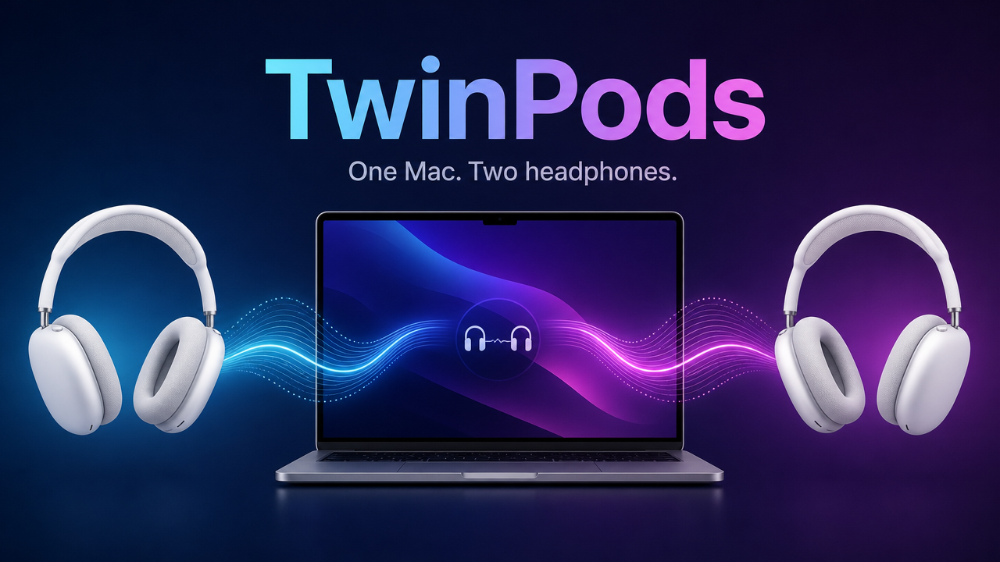

<p align="center"></p>

# TwinPods

Play your Mac's audio through **two (or more) Bluetooth headphones or speakers at the same time**.

A tiny menu bar app for macOS. It builds a CoreAudio multi-output device from the Bluetooth outputs
you have connected and sets it as the default output. No drivers, no dependencies.

## Install

1. Download `TwinPods.app.zip` from the [latest release](https://github.com/xXxMiltonxXx/TwinPods/releases/latest).
2. Unzip it and drag `TwinPods.app` to `/Applications`.
3. First launch: right-click the app → **Open** (it is ad-hoc signed, not notarized).

## Use

Click the headphones icon in the menu bar and choose **Play on both headphones**.

- The menu shows which Bluetooth outputs are connected.
- With fewer than two connected, the button is disabled.
- If a headphone disconnects while active, TwinPods turns itself off and restores your previous output.
- If you connect another one while active, it is added automatically.

### CLI

```bash
twinpods on     # play on all connected Bluetooth outputs
twinpods off    # restore the previous output
twinpods list   # list outputs, Bluetooth ones marked [BT]
```

## Build from source

```bash
./build.sh
```

Needs macOS and the Xcode command line tools (`xcode-select --install`). Output: `TwinPods.app`, `twinpods`, and `dist/`.

## Limits

Bluetooth bandwidth is the real limit, not the software. Two devices usually work well; three or more
may stutter or drift out of sync. For many speakers, prefer AirPlay or the manufacturer's own party mode.

## Layout

- `Core.swift`: CoreAudio logic shared by both targets
- `menubar/main.swift`: menu bar app
- `cli/main.swift`: command line tool

## License

[MIT](LICENSE)
